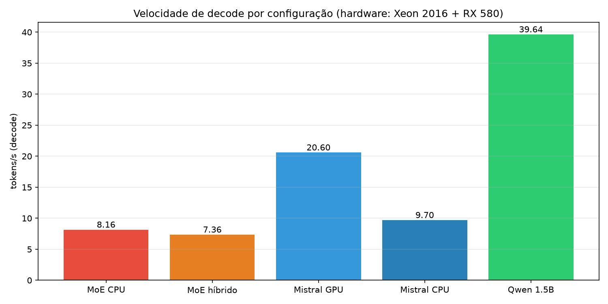

# Small Model Orchestration

**Um agente de IA local e útil não emerge de um modelo maior, mas de um sistema que roteia, cacheia e complementa modelos pequenos com ferramentas externas.**

Este repositório consolida os achados de dois estudos anteriores — [`llm-hardware-envelope`](https://github.com/JPauloNGA/llm-hardware-envelope) (envelope de hardware) e [`llm_study`](https://github.com/JPauloNGA/llm_study) (escolha de modelo e configuração) — em uma tese única: **a orquestração eficiente de modelos pequenos é uma alternativa viável a modelos monolíticos gigantes em hardware limitado.**

## A tese em três partes

1. **O hardware define o envelope, não o modelo.** Em um Xeon de 2016 com uma RX 580 de 8 GB, um MoE de 30B roda em CPU pura a 8,16 tok/s, enquanto o split híbrido com GPU cai para 7,36 tok/s. A GPU só compensa quando o modelo cabe inteiro na VRAM.

2. **O cache é a alavanca mais importante.** O prefix caching reduz o TTFT de 8.415 ms para 847 ms no Mistral 7B (9,9×) e de 67.960 ms para 911 ms no Qwen3-30B-A3B (74,6×). Um agente que responde em ~1 s depende mais de cache do que de um modelo maior.

3. **A orquestração compensa a falta de parâmetros.** Um roteador de 1,5B classificou 100% das categorias corretamente e direcionou para o especialista certo. Um modelo de 1,5B com RAG respondeu com precisão técnica que o modelo base não tinha. O especialista pequeno entregou mais qualidade por token que o generalista maior.

## O que medimos

| Dimensão | Achado | Fonte |
|---|---|---|
| **GPU vs CPU (denso)** | Mistral 7B: GPU 20,6 tok/s, CPU 9,7 tok/s | `llm-hardware-envelope` |
| **GPU vs CPU (MoE)** | Qwen3-30B-A3B: CPU pura 8,16 tok/s, híbrido 7,36 tok/s | `llm-hardware-envelope` |
| **Prefix caching (denso)** | TTFT: 8.415 ms → 847 ms (9,9×) | `llm-hardware-envelope` |
| **Prefix caching (MoE)** | TTFT: 67.960 ms → 911 ms (74,6×) | `llm-hardware-envelope` |
| **Pipeline de voz** | STT 207 + LLM 604 + TTS 81 = 892 ms | `llm-hardware-envelope` |
| **KV caching** | Segunda pergunta no mesmo contexto: 0,32 s vs 0,58 s | `llm_study` |
| **Quantização** | Q4 é 9% mais rápido e 40% menor que Q8 | `llm_study` |
| **Idioma** | Inglês gera 28% menos tokens que PT-BR | `llm_study` |
| **Modelo** | Qwen 1.5B é ~80% mais rápido que Llama 3.2 1B | `llm_study` |
| **Roteamento** | Classificador 100% correto; especialista responde em 7–24 s | `llm_study` |
| **RAG** | Modelo de 1,5B com RAG responde com precisão técnica sem fine-tuning | `llm_study` |
| **Especialista vs generalista** | Especialista entrega mais qualidade por token, generalista é mais rápido | `llm_study` |



## A arquitetura

O sistema tem quatro camadas. Nenhuma delas exige um modelo maior que 7B.

```
[Usuário]
    ↓
[Classificador (Qwen 1.5B)]
    ↓
[Cache de contexto] ← prefix caching + KV caching
    ↓
[Especialistas por categoria]
    ├── código        → Qwen 2.5 Coder 7B
    ├── mecatrônica   → Jarvis 1.5B (system prompt técnico)
    ├── visão         → Llava 7B
    └── geral         → Qwen 2.5 3B (fallback)
    ↓
[RAG (base de conhecimento)] ← quando o especialista precisa de fatos
    ↓
[Resposta + TTS (Piper)]
```

**Classificador.** Um modelo pequeno (Qwen 1.5B) lê a pergunta e decide a categoria. O prompt tem 5 categorias e exemplos. O classificador acertou 100% das categorias nos testes, com tempo de ~2,3 s.

**Cache de contexto.** Duas camadas: prefix caching (para o system prompt fixo) e KV caching (para o histórico da conversa). O prefix caching reduz o TTFT em 9,9× no denso e 74,6× no MoE. O KV caching reduz a latência da segunda pergunta no mesmo contexto em ~45%.

**Especialistas.** Cada categoria tem um modelo dedicado. O especialista de mecatrônica (Jarvis 1.5B) é o mais rápido (~7 s total, 38,92 tok/s). Os modelos 7B (Coder e Llava) são mais lentos na RX 580 porque precisam ser carregados/descarregados a cada chamada.

**RAG.** Quando o especialista precisa de fatos que não estão no modelo, o RAG injeta o contexto relevante. O RAG adicionou apenas ~0,3–0,8 s ao tempo total, e o modelo gerou menos tokens (mais direto), compensando a busca.

## O que isso implica

**Para hardware limitado:** um agente local não precisa de um modelo de 70B. Precisa de um classificador pequeno, um cache agressivo, e especialistas que caibam na VRAM. A orquestração compensa a falta de parâmetros.

**Para o desenvolvimento de agentes:** a qualidade da resposta não é linearmente proporcional ao tamanho do modelo. O especialista pequeno entregou código mais idiomático que o generalista maior, porque o treinamento e o alinhamento importam mais que o número de parâmetros.

**Para a pesquisa em AGI:** a inteligência útil pode emergir da composição de modelos especializados pequenos, não de um modelo monolítico gigante. O Isaque 2.0 propõe isso com colunas DoRA em um modelo congelado; este repositório propõe a versão factível: roteamento de modelos inteiros por categoria, com RAG como memória externa.

## O que não está aqui

Este repositório contém **apenas documentação, dados consolidados e gráficos**. Os scripts de implementação (roteador, RAG, benchmarks) estão nos repositórios satélite e não são públicos. O objetivo é mostrar **o que** o sistema faz e **quais resultados** produz, não **como** ele decide.

## Referências

- [`llm-hardware-envelope`](https://github.com/JPauloNGA/llm-hardware-envelope): envelope de hardware, GPU vs CPU, MoE, prefix caching, pipeline de voz.
- [`llm_study`](https://github.com/JPauloNGA/llm_study): escolha de modelo, quantização, idioma, roteamento, RAG.
- [`trunk-and-branches-isaque-2`](https://github.com/lcsmotta7/trunk-and-branches-isaque-2): inspiração para a ideia de especialização (colunas DoRA em modelo congelado).